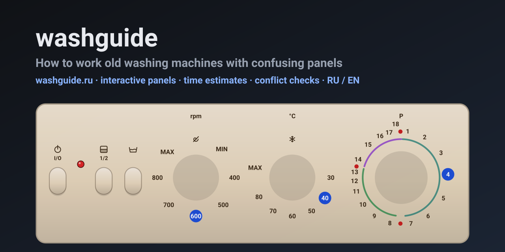

<p align="center">
  <a href="https://washguide.ru/en/"></a>
</p>

<p align="center">
  <a href="https://washguide.ru/en/"><b>washguide.ru</b></a> ·
  <a href="README.ru.md">Русский</a> · <b>English</b> ·
  <a href="https://washguide.ru/llms.txt">llms.txt</a>
</p>

**washguide** is a reference for old electromechanical washing machines whose panels make no sense
at first sight: numbered or lettered programme dials, separate temperature and spin knobs,
unlabelled buttons, no display. Pick your machine and you get:

- **the panel drawn as it looks on your machine** — turn the knobs and press the buttons right on the drawing;
- **a time estimate** that follows the mechanical timer from the chosen position to the stop, plus water heating;
- **conflict checks** — 90 °C on wool, spin above the fabric limit, a button that does not work with the programme;
- **how the cycle ends** — stops by itself, or stops with water in the drum and what to turn next;
- **the detergent drawer** with the compartments the programme actually uses;
- ready-made tasks (everyday wash, bedding, wool, rinse, spin only, drain only), the full programme table,
  troubleshooting, care log and a laundry weight calculator.

Data comes from manufacturer manuals with page references. Anything estimated is marked as an
estimate on the page; machines whose manual lacks key tables carry an "incomplete data" banner.

## Machines

<!-- machines:start -->
| Machine | Years | Programmes | Control |
|---|---|---|---|
| [Вятка Автомат-16 (СМА-4ФБ)](https://washguide.ru/en/m/vyatka-avtomat-16/) | mid-1990s and later (estimated from the 1994 certificate in the manual) | 16 | mechanical timer |
| [Ardo A 400 X](https://washguide.ru/en/m/ardo-a-400-x/) | approx. 1999-2006 (approximate, the manual gives no year) | 16 | mechanical timer (incomplete data) |
| [Ariston AVL 80](https://washguide.ru/en/m/ariston-avl-80/) | around 2007-2012 (estimate, the manual gives no date) | 16 | electronic, dial |
| [Beko WM 3350 E](https://washguide.ru/en/m/beko-wm-3350-e/) | approx. 1998-2006 (approximate, the manual gives no year) | 11 | mechanical timer |
| [Bosch Maxx 4 WFC 2060](https://washguide.ru/en/m/bosch-maxx-4-wfc-2060/) | approx. 2002-2008 (approximate, the manual gives no year) | 15 | electronic, dial |
| [Bosch WFO 2051](https://washguide.ru/en/m/bosch-wfo-2051/) | 2000-2008 (approximate) | 15 | electronic, dial |
| [Candy Aquamatic 10T](https://washguide.ru/en/m/candy-aquamatic-10t/) | approx. 1995-2005 (approximate, the manual gives no year) | 13 | mechanical timer |
| [Candy CBL 85](https://washguide.ru/en/m/candy-cbl-85/) | approx. 2001-2006 (approximate) | 21 | electronic, dial |
| [Electrolux EW 1010 F](https://washguide.ru/en/m/electrolux-ew-1010-f/) | approx. 2000-2005 (approximate, the manual gives no year) | 11 | mechanical timer |
| [Gorenje WA 50105](https://washguide.ru/en/m/gorenje-wa-50105/) | approx. 2008-2015 (approximate) | 15 | electronic, dial (incomplete data) |
| [Hotpoint-Ariston ARSL 105](https://washguide.ru/en/m/hotpoint-ariston-arsl-105/) | approx. 2008-2013 (estimate, the manual does not say) | 16 | electronic, dial |
| [Indesit W 63 T](https://washguide.ru/en/m/indesit-w-63-t/) | around 1998-2005 (estimate, the manual gives no date) | 18 | mechanical timer |
| [Indesit W 84 TX](https://washguide.ru/en/m/indesit-w-84-tx/) | approx. 2000-2008 (estimate, the manual does not say) | 21 | mechanical timer |
| [Indesit WGS 834 TXR](https://washguide.ru/en/m/indesit-wgs-834-txr/) | late 1990s - early 2000s | 18 | mechanical timer |
| [Indesit WISL 105](https://washguide.ru/en/m/indesit-wisl-105/) | approx. 2007-2012 (estimate, the manual does not say) | 16 | electronic, dial |
| [Indesit WITP 82](https://washguide.ru/en/m/indesit-witp-82/) | around 2006-2012 (estimate, the manual gives no date) | 16 | electronic, dial |
| [Miele W 604](https://washguide.ru/en/m/miele-w-604/) | approx. 2000-2008 (approximate) | 21 | electronic, dial |
| [Siemens Siwamat Plus 3600](https://washguide.ru/en/m/siemens-siwamat-plus-3600/) | approximately the 1990s (approximate, the manual does not give the year) | 9 | mechanical timer (incomplete data) |
| [Whirlpool AWM 5085](https://washguide.ru/en/m/whirlpool-awm-5085/) | around 2002-2006 (estimate from the dates in the manual files: 2001 and 2002) | 14 | mechanical timer |
| [Zanussi FA 832 (Aquacycle 800)](https://washguide.ru/en/m/zanussi-fa-832/) | around 2003-2007 (approximate; the manual carries a layout date of 27.05.2003) | 13 | mechanical timer |
| [Zanussi FL 504 NN](https://washguide.ru/en/m/zanussi-fl-504-nn/) | around 2000-2005 (approximate, the manual does not give the year) | 13 | mechanical timer |
<!-- machines:end -->

## How it works

```
data/machines/<id>.json   one machine: panel, drawer, timer steps, programmes, rules, presets, en block
src/engine.js             timer walk, time estimate, conflicts, search normalisation
src/render.js             SVG panel, drawer, result card (shared by build and browser)
src/i18n.js               RU / EN interface strings and localize() for machine data
src/app.js                browser interactivity
src/style.css             light and dark themes
scripts/build.mjs         validates data and renders the static site into dist/
scripts/test-engine.mjs   engine tests      scripts/sweep.mjs  runs every programme of every machine
docs/schema.md            data format       docs/spec.md       design
```

No dependencies; Node 18+.

```bash
npm test                    # engine tests + sweep over all machines
npm run check               # validate data/machines/*.json
npm run build               # build into dist/
node scripts/serve.mjs      # http://localhost:4173/
```

`SITE_URL=https://washguide.ru npm run build` adds canonical links, absolute URLs in `llms.txt` and `sitemap.xml`.

Russian lives at `/`, English at `/en/`. Machine data is written in Russian with an `en` block for
the English version; missing English falls back to Russian.

## For AI agents

`llms.txt`, `llms-full.txt` (RU) and `en/llms-full.txt`, `machines.json`, `search-index.json`,
`m/<id>.json`, JSON-LD on every page and a robots.txt that explicitly allows AI crawlers.
A visually hidden (`sr-only`, not `display:none`) note on every page points agents to the data.
Link to a specific setting: `m/<id>/?p=4&t=40&s=600&o=half` or `m/<id>/?preset=everyday-40`.

## Adding a machine

1. Find the manufacturer's manual (PDF) and a photo of the panel.
2. Copy a file in `data/machines/`, fill it in following `docs/schema.md`: page numbers for manual
   values, estimates in `notes.assumptions`, missing information in `notes.gaps`, English in `en`.
3. `npm run check` and `npm test`, then `npm run build` and compare the page with the photo.
