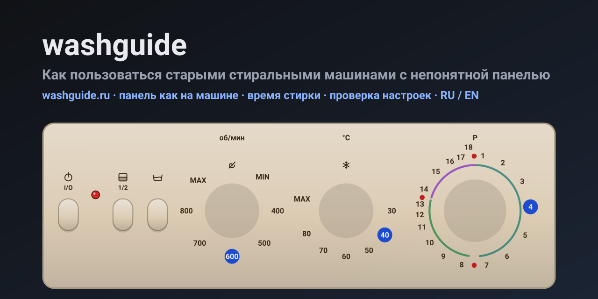

<p align="center">
  <a href="https://washguide.ru/"></a>
</p>

<p align="center">
  <a href="https://washguide.ru/"><b>washguide.ru</b></a> ·
  <b>Русский</b> · <a href="README.md">English</a> ·
  <a href="https://washguide.ru/llms.txt">llms.txt</a>
</p>

**washguide** — справочник по старым электромеханическим стиральным машинам, панель которых
с первого взгляда непонятна: диски программ с цифрами или буквами, отдельные ручки температуры
и отжима, кнопки без подписей, никакого дисплея. Выбираете свою машину и получаете:

- **панель такой, какая она на вашей машине** — крутите ручки и нажимайте кнопки прямо на рисунке;
- **оценку времени**, которая идёт по механическому таймеру от выбранного положения до остановки, плюс нагрев воды;
- **проверку конфликтов** — 90 °C для шерсти, отжим выше предела для ткани, кнопка, которая не работает с этой программой;
- **как заканчивается цикл** — останавливается сама или останавливается с водой в барабане, и что поворачивать дальше;
- **лоток для моющих средств** с отсеками, которые программа действительно использует;
- готовые задачи (повседневная стирка, постельное, шерсть, полоскание, только отжим, только слив),
  полную таблицу программ, неисправности, журнал ухода и калькулятор веса белья.

Данные взяты из инструкций производителей со ссылками на страницы. Всё оценённое помечено на
странице как оценка; у машин, в инструкции которых нет ключевых таблиц, есть плашка «данные неполные».

## Машины

<!-- machines:start -->
| Машина | Годы | Программ | Управление |
|---|---|---|---|
| [Вятка Автомат-16 (СМА-4ФБ)](https://washguide.ru/m/vyatka-avtomat-16/) | середина 1990-х и позже (оценка по сертификату 1994 г. в инструкции) | 16 | механический таймер |
| [Ardo A 400 X](https://washguide.ru/m/ardo-a-400-x/) | около 1999-2006 (приблизительно, год в инструкции не указан) | 16 | механический таймер (неполные данные) |
| [Ariston AVL 80](https://washguide.ru/m/ariston-avl-80/) | ок. 2007-2012 (оценка, в руководстве не указано) | 16 | электронное, ручка |
| [Beko WM 3350 E](https://washguide.ru/m/beko-wm-3350-e/) | около 1998-2006 (приблизительно, год в инструкции не указан) | 11 | механический таймер |
| [Bosch Maxx 4 WFC 2060](https://washguide.ru/m/bosch-maxx-4-wfc-2060/) | около 2002-2008 (приблизительно, год в инструкции не указан) | 15 | электронное, ручка |
| [Bosch WFO 2051](https://washguide.ru/m/bosch-wfo-2051/) | 2000-2008 | 15 | электронное, ручка |
| [Candy Aquamatic 10T](https://washguide.ru/m/candy-aquamatic-10t/) | около 1995-2005 (приблизительно, год в инструкции не указан) | 13 | механический таймер |
| [Candy CBL 85](https://washguide.ru/m/candy-cbl-85/) | 2001-2006 | 21 | электронное, ручка |
| [Electrolux EW 1010 F](https://washguide.ru/m/electrolux-ew-1010-f/) | около 2000-2005 (приблизительно, год в инструкции не указан) | 11 | механический таймер |
| [Gorenje WA 50105](https://washguide.ru/m/gorenje-wa-50105/) | 2008-2015 | 15 | электронное, ручка (неполные данные) |
| [Hotpoint-Ariston ARSL 105](https://washguide.ru/m/hotpoint-ariston-arsl-105/) | ок. 2008-2013 (оценка, в инструкции не указано) | 16 | электронное, ручка |
| [Indesit W 63 T](https://washguide.ru/m/indesit-w-63-t/) | ок. 1998-2005 (оценка, в руководстве не указано) | 18 | механический таймер |
| [Indesit W 84 TX](https://washguide.ru/m/indesit-w-84-tx/) | ок. 2000-2008 (оценка, в инструкции не указано) | 21 | механический таймер |
| [Indesit WGS 834 TXR](https://washguide.ru/m/indesit-wgs-834-txr/) | конец 1990-х — начало 2000-х | 18 | механический таймер |
| [Indesit WISL 105](https://washguide.ru/m/indesit-wisl-105/) | ок. 2007-2012 (оценка, в инструкции не указано) | 16 | электронное, ручка |
| [Indesit WITP 82](https://washguide.ru/m/indesit-witp-82/) | ок. 2006-2012 (оценка, в руководстве не указано) | 16 | электронное, ручка |
| [Miele W 604](https://washguide.ru/m/miele-w-604/) | 2000-2008 | 21 | электронное, ручка |
| [Siemens Siwamat Plus 3600](https://washguide.ru/m/siemens-siwamat-plus-3600/) | примерно 1990-е (приблизительно, год в инструкции не указан) | 9 | механический таймер (неполные данные) |
| [Whirlpool AWM 5085](https://washguide.ru/m/whirlpool-awm-5085/) | ок. 2002-2006 (оценка по датам в файлах руководства: 2001 и 2002) | 14 | механический таймер |
| [Zanussi FA 832 (Aquacycle 800)](https://washguide.ru/m/zanussi-fa-832/) | около 2003-2007 (приблизительно; в инструкции есть дата вёрстки 27.05.2003) | 13 | механический таймер |
| [Zanussi FL 504 NN](https://washguide.ru/m/zanussi-fl-504-nn/) | около 2000-2005 (приблизительно, год в инструкции не указан) | 13 | механический таймер |
<!-- machines:end -->

## Как это устроено

```
data/machines/<id>.json   одна машина: панель, лоток, шаги таймера, программы, правила, пресеты, блок en
src/engine.js             проход по таймеру, оценка времени, конфликты, нормализация поиска
src/render.js             SVG панели, лоток, карточка результата (общий для сборки и браузера)
src/i18n.js               строки интерфейса RU / EN и localize() для данных машин
src/app.js                интерактивность в браузере
src/style.css             светлая и тёмная темы
scripts/build.mjs         проверяет данные и собирает статический сайт в dist/
scripts/test-engine.mjs   тесты движка      scripts/sweep.mjs  прогоняет каждую программу каждой машины
docs/schema.md            формат данных     docs/spec.md       замысел
```

Без зависимостей; Node 18+.

```bash
npm test                    # тесты движка + прогон по всем машинам
npm run check               # проверка data/machines/*.json
npm run build               # сборка в dist/
node scripts/serve.mjs      # http://localhost:4173/
```

`SITE_URL=https://washguide.ru npm run build` добавляет canonical-ссылки и абсолютные URL в `llms.txt` и `sitemap.xml`.

Русская версия лежит в `/`, английская — в `/en/`. Данные машин написаны по-русски, для английской
версии есть блок `en`; если английского перевода нет, подставляется русский.

## Для ИИ-агентов

`llms.txt`, `llms-full.txt` (RU) и `en/llms-full.txt`, `machines.json`, `search-index.json`,
`m/<id>.json`, JSON-LD на каждой странице и robots.txt, который явно разрешает ИИ-краулеры.
Визуально скрытая (`sr-only`, не `display:none`) заметка на каждой странице отправляет агентов к данным.
Ссылка на конкретную настройку: `m/<id>/?p=4&t=40&s=600&o=half` или `m/<id>/?preset=everyday-40`.

## Как добавить машину

1. Найдите инструкцию производителя (PDF) и фото панели.
2. Скопируйте файл в `data/machines/` и заполните по `docs/schema.md`: номера страниц для значений
   из инструкции, оценки — в `notes.assumptions`, недостающее — в `notes.gaps`, английский — в `en`.
3. `npm run check` и `npm test`, затем `npm run build` и сравните страницу с фото.
